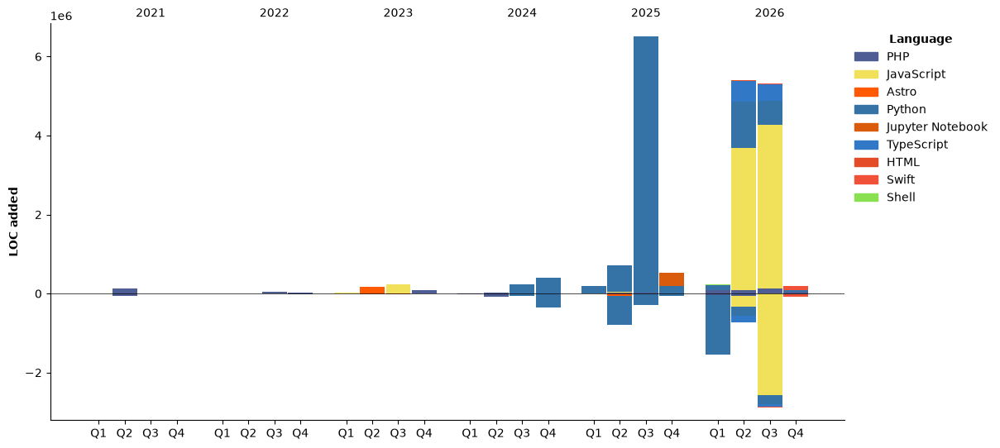

<!--START_SECTION:waka-->


**我是早鸟 🐤** 

```text
🌞 早晨                     5773 commits        ████████░░░░░░░░░░░░░░░░░   31.99 % 
🌆 白天                     7961 commits        ███████████░░░░░░░░░░░░░░   44.12 % 
🌃 傍晚                     2066 commits        ███░░░░░░░░░░░░░░░░░░░░░░   11.45 % 
🌙 晚上                     2244 commits        ███░░░░░░░░░░░░░░░░░░░░░░   12.44 % 
```
📅 **星期五 时的我最有干劲** 

```text
星期一                      3076 commits        ████░░░░░░░░░░░░░░░░░░░░░   17.05 % 
星期二                      2875 commits        ████░░░░░░░░░░░░░░░░░░░░░   15.93 % 
星期三                      2913 commits        ████░░░░░░░░░░░░░░░░░░░░░   16.14 % 
星期四                      3440 commits        █████░░░░░░░░░░░░░░░░░░░░   19.06 % 
星期五                      3500 commits        █████░░░░░░░░░░░░░░░░░░░░   19.40 % 
星期六                      1400 commits        ██░░░░░░░░░░░░░░░░░░░░░░░   07.76 % 
星期日                      840 commits         █░░░░░░░░░░░░░░░░░░░░░░░░   04.66 % 
```


📊 **本周消耗时间** 

```text
💬 编程语言: 
Python                   8 hrs 23 mins       ████████░░░░░░░░░░░░░░░░░   31.54 % 
Markdown                 8 hrs 19 mins       ████████░░░░░░░░░░░░░░░░░   31.31 % 
Other                    3 hrs 48 mins       ████░░░░░░░░░░░░░░░░░░░░░   14.34 % 
PHP                      1 hr 57 mins        ██░░░░░░░░░░░░░░░░░░░░░░░   07.39 % 
Swift                    1 hr 40 mins        ██░░░░░░░░░░░░░░░░░░░░░░░   06.29 % 

🔥 编辑器: 
Claude Code              25 hrs 49 mins      ████████████████████████░   97.02 % 
VS Code                  47 mins             █░░░░░░░░░░░░░░░░░░░░░░░░   02.98 % 
```

🤖 **AI Coding This Week** 

```text
⏱ AI Coding Time: 26 hrs 10 mins (98.32%)

✍️ 7,069 lines written by AI, 4 lines written by hand (99.94% AI-written)

🔤 40,004,078 Input Tokens, 1,681,276 Output Tokens

💵 $2558.37 Estimated AI Cost This Week

🧠 30 AI Sessions, 280 AI Prompts

GLM                      7,005 lines         █████████████████████████   100.00 % 

🔎 AI Coding Insights:
🤖 AI-Driven — 99.94% of written lines came from AI
📄 Detailed Prompter — average 953 characters per prompt
🔁 Iterative Prompter — average 9 prompts per session
🚀 High AI Trust — 0.14% of changed lines were hand-edited
```

**我最常使用 Python** 

```text
Python                   10 repos            █████████░░░░░░░░░░░░░░░░   35.71 % 
JavaScript               6 repos             █████░░░░░░░░░░░░░░░░░░░░   21.43 % 
PHP                      4 repos             ████░░░░░░░░░░░░░░░░░░░░░   14.29 % 
Jupyter Notebook         2 repos             ██░░░░░░░░░░░░░░░░░░░░░░░   07.14 % 
Astro                    1 repo              █░░░░░░░░░░░░░░░░░░░░░░░░   03.57 % 
```


**时间线**




 Last Updated on 01/11/2026 18:06:07 UTC
<!--END_SECTION:waka-->
